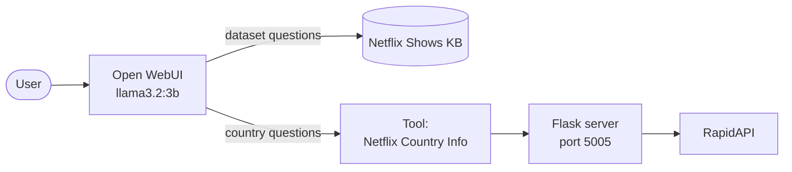

# HW07 - Open WebUI: Netflix KB + Local Tool Server

A local AI assistant that answers from two sources:

1. Knowledge Base - the Kaggle [Netflix Movies & TV Shows](https://www.kaggle.com/datasets/shivamb/netflix-shows) CSV, uploaded to Open WebUI.
2. Live country tool - a local Flask server that returns country facts such as currency, ISO code, phone code, and timezones from RapidAPI's Country State City API.



## Quick start

Prerequisites:

- Python 3.12
- Open WebUI
- Ollama with `llama3.2:3b` for chat
- `nomic-embed-text` for Knowledge Base embeddings
- Free RapidAPI key for Country State City - Search REST API

```powershell
python -m venv .venv
.\.venv\Scripts\Activate.ps1
pip install -r requirements.txt
Copy-Item .env.example .env
python tools_server.py
```

Add your real RapidAPI key to `.env` before using the live country tool:

```env
RAPIDAPI_KEY=your_real_rapidapi_key_here
```

Verify the local server:

```powershell
python -m pytest -v
start http://localhost:5005/health
start http://localhost:5005/country/France
```

Expected test result:

```text
15 passed
```

<details>
<summary>Run the server with Docker instead</summary>

```powershell
docker compose up --build
```

The same endpoints are available on port `5005`. The container reads `RAPIDAPI_KEY` from `.env`.
</details>

<details>
<summary>Re-download the dataset</summary>

The CSV is already included in `data/`. Re-download only if needed.

Requires Kaggle CLI credentials with `kaggle.json` or `KAGGLE_USERNAME` and `KAGGLE_KEY`.

```powershell
python data/download_dataset.py
```
</details>

## Wire up Open WebUI

1. Knowledge Base: go to Workspace -> Knowledge -> create `Netflix Shows KB` -> upload `data/netflix_titles.csv` -> wait for indexing.
2. Tool: go to Workspace -> Tools -> create a new tool -> paste `openwebui_function_tool.py` -> save and enable `Netflix Country Info`.
3. System prompt: paste `system_prompt.txt` into the model or chat system prompt.

<details>
<summary>Tool base URL</summary>

The tool base URL depends on where Open WebUI and the Flask server run.

| Setup | `base_url` |
|---|---|
| Open WebUI in Docker, Flask server on host | `http://host.docker.internal:5005` |
| Open WebUI and tool server in the same Docker Compose network | `http://tools-server:5005` |
| Open WebUI directly on the host | `http://localhost:5005` |
</details>

## Demo questions and expected outputs

Use these 5 questions to validate the homework requirements.

| # | Input | Expected output | Validates |
|---|---|---|---|
| 1 | `#netflix-shows-kb From the uploaded Netflix CSV, list the dataset name and 5 columns. Answer shortly.` | Identifies the Netflix Shows dataset and lists columns such as `title`, `country`, `release_year`, `rating`, and `duration`. | KB upload and indexing |
| 2 | `#netflix-shows-kb Return 3 Netflix title names from India that are found in the uploaded CSV. Answer only with title names.` | Returns only real title names from `netflix_titles.csv` where the country contains India. It should not invent missing titles. | KB retrieval |
| 3 | `What currency is used in Japan? Answer shortly.` | Calls `Netflix Country Info` and returns Japan country data. Expected currency: `JPY`. Expected ISO code: `JP`. | Tool-only flow |
| 4 | `#netflix-shows-kb Show 3 Netflix titles from Japan and tell me Japan's currency.` | Uses the KB for Netflix titles from Japan and the tool for live country data. Expected currency: `JPY`. | KB + tool combined flow |
| 5 | `What country details do you have for Atlantis?` | Returns a clear not-found response and does not invent fake country data. | Edge-case handling |

## Expected proof in Open WebUI

For KB questions, the chat should show:

```text
Netflix Shows KB - Collection
Source: netflix_titles.csv
```

For tool-only questions, enable only the `Netflix Country Info` tool. The chat should show the tool call and return country data from the local server.

For the combined question, the answer should include both:

```text
Netflix titles from the uploaded CSV
Country facts from the local tool
```

## API

| Endpoint | Returns |
|---|---|
| `GET /health` | `{"status": "ok", "server": "tools_server", "port": 5005}` |
| `GET /country/<name>` | Country facts from RapidAPI. Matching is case-insensitive and accent-tolerant, for example `fran` can match France and `Côte d'Ivoire` is supported. |

Errors return structured JSON:

| Case | HTTP status |
|---|---|
| Missing API key | `500` |
| Unknown country | `404` |
| Upstream timeout | `503` |
| Upstream unauthorized, rate limit, or server error | `401`, `429`, or `500` |

<details>
<summary>Project structure</summary>

```text
hw07-openwebui/
├── README.md
├── SUBMISSION.md
├── tools_server.py
├── test_tools_server.py
├── openwebui_function_tool.py
├── system_prompt.txt
├── requirements.txt
├── .env.example
├── Dockerfile
├── docker-compose.yml
└── data/
    ├── download_dataset.py
    └── netflix_titles.csv
```
</details>

## Submitting

Submit the project files, screenshots, and final demo evidence. See [SUBMISSION.md](SUBMISSION.md) for the screenshot checklist and demo script.
