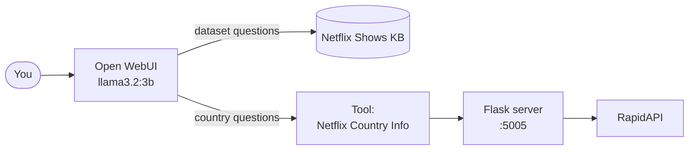

# HW07 — Open WebUI: Netflix KB + Local Tool Server

A local AI assistant that answers from **two sources**:

1. 📚 **Knowledge Base** — the Kaggle [Netflix Movies & TV Shows](https://www.kaggle.com/datasets/shivamb/netflix-shows) CSV, uploaded to Open WebUI.
2. 🌍 **Live tool** — a local Flask server that returns country facts (currency, ISO code, phone code, timezones) from RapidAPI's *Country State City* API.



## Quick start

> **Prerequisites:** Python 3.12 · Open WebUI (Docker) · Ollama with `llama3.2:3b` (chat) and `nomic-embed-text` (embeddings) · a free RapidAPI key for *Country State City - Search REST API*.

```powershell
python -m venv .venv
.\.venv\Scripts\Activate.ps1
pip install -r requirements.txt
Copy-Item .env.example .env     # then put your real RAPIDAPI_KEY in .env
python tools_server.py          # → http://localhost:5005
```

Verify it works:

```powershell
python -m pytest -v             # 15 passed
start http://localhost:5005/health
start http://localhost:5005/country/France
```

<details>
<summary>🐳 Run the server with Docker instead</summary>

```powershell
docker compose up --build
```

Same endpoints on port `5005`; the container reads `RAPIDAPI_KEY` from `.env`.
</details>

<details>
<summary>⬇️ Re-download the dataset (optional — CSV is already in <code>data/</code>)</summary>

Requires Kaggle CLI credentials (`kaggle.json` or `KAGGLE_USERNAME`/`KAGGLE_KEY`):

```powershell
python data/download_dataset.py
```
</details>

## Wire up Open WebUI

- [ ] **Knowledge Base** — Workspace → Knowledge → create `Netflix Shows KB` → upload `data/netflix_titles.csv` → wait for indexing.
- [ ] **Tool** — Workspace → Tools → new tool → paste `openwebui_function_tool.py` → save & enable it on your model.
- [ ] **System prompt** — paste `system_prompt.txt` into the model or chat system prompt.

<details>
<summary>⚙️ Tool base URL — pick the one that matches your setup</summary>

The tool's URL is a **Valve** (tool settings ⚙️ in Open WebUI — no code edit needed):

| Your setup | `base_url` |
|---|---|
| Open WebUI in Docker, Flask server on host *(default)* | `http://host.docker.internal:5005` |
| Both in the same Docker Compose network | `http://tools-server:5005` |
| Open WebUI directly on the host | `http://localhost:5005` |
</details>

## Try it

| Ask | Answered by |
|---|---|
| `#netflix-shows-kb List 5 Netflix titles from India.` | 📚 KB |
| `What currency is used in Japan?` | 🌍 Tool |
| `#netflix-shows-kb Show 3 Netflix titles from Japan and tell me Japan's currency.` | 📚 + 🌍 Both |
| `What currency is used in Atlantis?` | Graceful "not found" — no hallucination |

## API

| Endpoint | Returns |
|---|---|
| `GET /health` | `{"status": "ok", "server": "tools_server", "port": 5005}` liveness check |
| `GET /country/<name>` | Country facts — case-insensitive, accent-tolerant (`fran` → France, `Côte d'Ivoire` works) |

Errors come back as structured JSON: missing API key → `500`, unknown country → `404`, upstream timeout → `503`, upstream `401/429/500` passed through.

<details>
<summary>📁 Project structure</summary>

```text
hw07-openwebui/
├── README.md                    # you are here
├── SUBMISSION.md                # what to submit + screenshot guide
├── tools_server.py              # Flask tool server (port 5005)
├── test_tools_server.py         # 15 pytest tests (mocked API)
├── openwebui_function_tool.py   # paste into Open WebUI → Tools
├── system_prompt.txt            # paste into model/chat system prompt
├── requirements.txt
├── .env.example                 # copy to .env, add RAPIDAPI_KEY
├── Dockerfile / docker-compose.yml
└── data/
    ├── download_dataset.py      # Kaggle download helper
    └── netflix_titles.csv       # 8,807 titles
```
</details>

## Submitting

See **[SUBMISSION.md](SUBMISSION.md)** for the screenshot checklist and demo script.
